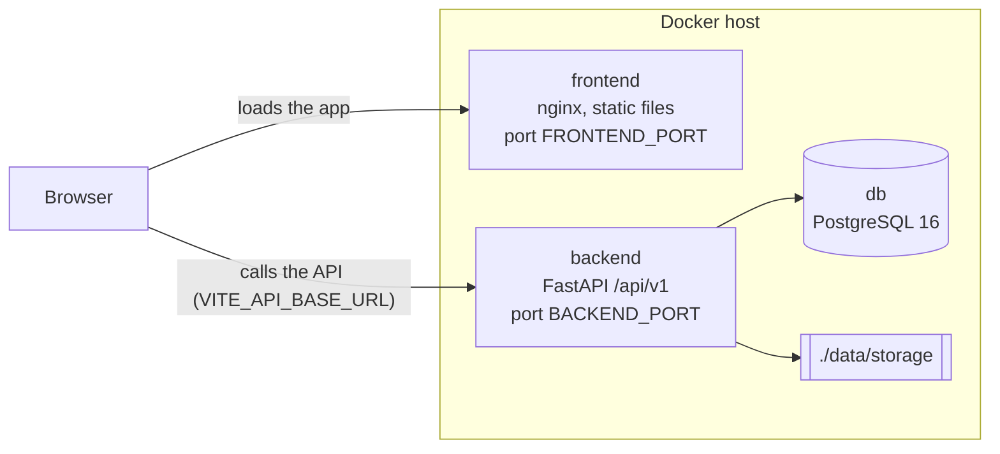

# FormScanner — Architecture

This document describes how FormScanner is built and run: its components, the structure of the repository, the backend layers, the startup sequence, the file storage and the configuration. What the product does is described in the [functional specification](functional-specification.md); the HTTP API in [api.md](api.md), the database in [data-model.md](data-model.md) and the printable PDF in [pdf-export.md](pdf-export.md).

## Contents

1. [Components](#1-components)
2. [Repository layout](#2-repository-layout)
3. [Backend](#3-backend)
4. [Frontend](#4-frontend)
5. [Database and migrations](#5-database-and-migrations)
6. [Startup sequence](#6-startup-sequence)
7. [File storage](#7-file-storage)
8. [Configuration reference](#8-configuration-reference)
9. [Tests](#9-tests)

## 1. Components

`docker-compose.yml` runs three services:

| Service | Image | Role |
|---|---|---|
| `db` | `postgres:16` | The database. Not published on the host: only the backend reaches it, on the compose network. Data in `./data/postgres` |
| `backend` | built from `backend/Dockerfile` (Python 3.12) | The HTTP API under `/api/v1` (FastAPI, served by uvicorn). Renders the printable PDFs, ingests the scanned sheets, runs the extraction. Files in `./data/storage` |
| `frontend` | built from `frontend/Dockerfile` (Node 24 for the build, nginx to serve) | The single-page application. nginx serves the static files only |



The browser calls the backend **directly**: nginx does not proxy `/api`. For this reason the address of the API is built into the frontend (`VITE_API_BASE_URL`, read when the image is built) and the backend must allow the frontend's origin in CORS (`CORS_ORIGINS`).

The backend image also contains the native tools the pipeline needs: Tesseract with the English and Italian language data (OCR of free-text areas), the ZBar library (QR codes and barcodes) and the DejaVu fonts (text in the printable PDF). OpenCV, PyMuPDF and Pillow come from the Python requirements.

## 2. Repository layout

```text
.
├── docker-compose.yml          # the three services: db, backend, frontend
├── .env.example                # configuration to copy into .env
├── README.md
├── .github/
│   ├── workflows/              # continuous integration (section 9)
│   ├── ISSUE_TEMPLATE/
│   └── pull_request_template.md
├── backend/
│   ├── Dockerfile
│   ├── requirements.txt        # runtime dependencies
│   ├── requirements-dev.txt    # runtime + test dependencies
│   ├── alembic.ini
│   ├── alembic/
│   │   ├── env.py              # reads DATABASE_URL
│   │   └── versions/           # migrations
│   ├── pytest.ini
│   ├── app/
│   │   ├── main.py             # FastAPI application, CORS, startup checks
│   │   ├── bootstrap.py        # run before uvicorn: directories, initial administrator
│   │   ├── api/v1/
│   │   │   ├── api.py          # mounts every router under /api/v1
│   │   │   └── endpoints/      # one module per resource
│   │   ├── core/               # configuration, security, request dependencies
│   │   ├── db/                 # engine and session
│   │   ├── models/             # SQLAlchemy models and enums
│   │   ├── schemas/            # Pydantic request and response models
│   │   ├── repositories/       # queries
│   │   ├── services/           # business rules, extraction, export
│   │   └── utils/              # pure helpers: layout, codes, image processing
│   └── tests/                  # see section 9
├── frontend/
│   ├── Dockerfile
│   ├── nginx.conf
│   ├── package.json
│   ├── vite.config.ts
│   ├── e2e/                    # browser end-to-end tests (Playwright)
│   └── src/                    # see frontend/README.md
└── docs/
    ├── specification/          # functional specification and technical documents
    └── user-guide/             # user guide, one file per chapter, pictures in images/
```

## 3. Backend

### 3.1 Layers

A request goes through four layers, each with one job:

| Layer | Folder | Job |
|---|---|---|
| Endpoints | `app/api/v1/endpoints/` | HTTP only: path, parameters, request and response schemas, authentication dependencies. No business rules |
| Services | `app/services/` | Business rules, authorization checks on the resource, transactions, audit events, files on disk |
| Repositories | `app/repositories/` | SQLAlchemy queries; they flush, the caller commits |
| Models | `app/models/` | Tables, enums, relationships (see [data-model.md](data-model.md)) |

Next to them:

- `app/schemas/` — Pydantic models of requests and responses. The OpenAPI document of the API is generated from them (see [api.md](api.md)).
- `app/core/config.py` — the settings, read from the environment (section 8).
- `app/core/security.py` — password hashing (bcrypt), password policy, JWT access tokens.
- `app/core/deps.py` — FastAPI dependencies: database session, current user, administrator check, owner check.
- `app/utils/` — pure helpers with no database access: layout of questions and matrices, alignment marks, code rendering and payloads, bubble sampling, sheet alignment, image validation, SVG sanitizing, upload file names.

A few rules have a single home, and every caller goes through it:

| Rule | Module |
|---|---|
| Whether a reading can be confirmed or accepted in bulk during review | `services/review_rules.py` |
| How an answer is scored | `services/scoring_rules.py` |
| Effective confidence threshold of a batch | `services/confidence_threshold_service.py` |
| Files on disk: names, directories, path checks | `services/storage_service.py` |
| Layout of the printable PDF: bubbles, alignment marks, reserved bands | `utils/question_layout.py`, `utils/matrix_layout.py`, `utils/alignment_marks.py`, shared by the export and the extraction and mirrored by `frontend/src/utils/exportLayout.ts`; the other constants are listed in [pdf-export.md, §6](pdf-export.md#6-constants-shared-with-the-canvas) |

### 3.2 Long operations and concurrency

The API is synchronous: each request runs in one database transaction, in uvicorn's thread pool.

- **Matching** runs inside the upload request: it only compares values already read from the sheets.
- **Extraction** runs only when an operator asks for it (`POST /api/v1/submission-batches/{batch_id}/run-extraction`) and reads every page image of the batch: one request and one transaction that can last minutes. While it runs, a PostgreSQL advisory lock on the batch refuses a second run, "Review anyway", a change of the threshold, and closing or reopening a submission of that batch with a `409 EXTRACTION_RUNNING`; nobody waits. The lock ends with the transaction, also if the process dies.
- **Review** of a submission is held by one reviewer at a time with a lock stored on the submission, and every save carries the version of the submission it was based on (see [api.md](api.md)).

### 3.3 Audit

Changes write a row to `audit_logs` through `services/audit_service.py`: user management and profiles, projects and their members, variants and pages, page objects, batches, uploads, matching and extraction runs, review actions, closing and reopening of submissions. The action is a dotted name (`form_variant.published`, `submission.closed`…). `GET /api/v1/audit` returns every row to an administrator and only the rows of their own actions to any other user.

## 4. Frontend

React 18 and TypeScript, built with Vite, with react-router and TanStack Query; no UI component library. The editor of the printable pages is a canvas written in the project. The structure of `src/`, the build and the checks are described in [frontend/README.md](../../frontend/README.md).

The frontend reads the API address from `VITE_API_BASE_URL` at build time. In the Docker image nginx serves the build and falls back to `index.html` for client-side routes.

## 5. Database and migrations

The schema is managed by Alembic (`backend/alembic/`). The migration history starts from one initial migration, `a7c3e9d1f5b2_initial_schema`, which creates the whole schema. `alembic/env.py` takes the connection string from `DATABASE_URL`.

With `docker-compose.yml` the migrations run automatically at every start of the backend (section 6): a new version of the code brings its schema with it.

Commands, from `backend/` with `DATABASE_URL` set (or inside the container with `docker compose exec backend …`):

```bash
alembic upgrade head        # apply every pending migration
alembic current             # migration the database is at
alembic heads               # latest migration of the code
alembic revision --autogenerate -m "describe the change"   # new migration from the models; review it before applying
```

The tables, enums and constraints are described in [data-model.md](data-model.md).

## 6. Startup sequence

The backend container runs three steps in order; if one fails, the next does not start and Docker restarts the container.

1. **`alembic upgrade head`** — brings the database to the schema of the code. The container starts only when the database answers (`depends_on` with `service_healthy`).
2. **`python -m app.bootstrap`** — creates the storage directories and makes sure the initial administrator exists:

   | Situation | What the bootstrap does |
   |---|---|
   | No user has `INITIAL_ADMIN_EMAIL` | Creates it, role `ADMIN`, enabled, password `INITIAL_ADMIN_PASSWORD` |
   | The user exists with another role | Sets the role to `ADMIN` |
   | The user exists and is disabled | Enables it |
   | `FORCE_RESET_ADMIN_PASSWORD=true` | Sets the password to `INITIAL_ADMIN_PASSWORD` |
   | Anything else | Nothing: the other fields of the user are never changed |

   Passwords are never printed. If the database cannot be reached, the bootstrap warns and goes on. If the schema is missing, it warns and goes on, except with `APP_ENV=production`, where it stops the container.
3. **uvicorn** starts the application. Before the first request, the application checks that every language in `OCR_LANGUAGE` is installed in Tesseract and stops otherwise; if the Tesseract binary itself is missing, it starts with a warning and the reading of free-text areas reports the missing engine.

`GET /api/v1/health` answers `{"status": "ok"}` once the application is up; the compose health check of the backend calls it.

## 7. File storage

Every file the backend keeps is under `STORAGE_PATH` (`/data/storage` in the container, `./data/storage` on the host). The database keeps the **absolute path** of each file on its row.

| Directory (setting) | Files | Path stored on |
|---|---|---|
| `OBJECT_IMAGES_DIR` | `{page_object_id}{ext}`: the picture of an IMAGE object | `image_object_configs.file_path` |
| `AVATAR_IMAGES_DIR` | `{user_id}{ext}`: a user's profile picture | `users.avatar_path` |
| `SUBMISSION_ORIGINALS_DIR` | `{submission_id}{ext}`: an uploaded PDF of scanned sheets, as received | — |
| `SUBMISSION_PAGES_DIR` | `{submission_page_id}.png`: one page rasterised from an uploaded PDF (150 dpi); `{submission_page_id}{ext}`: an uploaded JPEG or PNG sheet, stored as received; `{submission_page_id}_aligned.png`: the straightened sheet | `submission_pages.source_file_path`, `submission_pages.aligned_file_path` |

Rules that apply to every directory:

- **The name on disk comes from the id of the row**, never from the name the client sent. The client's file name is kept in the database for display only (`original_filename`, `avatar_original_filename`, `source_filename`).
- **The type comes from the content**, not from the extension or the declared `Content-Type`. The extension on disk is the one of the real format.
- **Every read re-checks the path**: a path stored on a row is resolved and must lie inside its directory, so a corrupted or edited row cannot make the backend read or delete a file elsewhere.
- **SVG pictures are sanitized before they are stored** (`utils/svg_sanitizer.py`): scripts, event handlers, `foreignObject` and external references are removed; an SVG that cannot be parsed safely is refused.
- **A cloned variant gets its own copy** of each picture, so deleting one variant never touches the other. Deleting an object, a variant or a project removes its files after the database commit.

The rules users see when they name scanned images (`<group>_page_<n>.<ext>`) are in the [functional specification, §5.5.1](functional-specification.md#551-file-naming-convention); the upload endpoints and their limits are in [api.md](api.md).

**Backup:** the whole state of an installation is `./data/postgres` (the database) and `./data/storage` (the files). Stop the services (`docker compose stop`) before copying `./data`, or take a `pg_dump` of the database together with a copy of `./data/storage`. The two must come from the same moment: the database refers to the files by path.

## 8. Configuration reference

The backend reads its settings from the environment (`app/core/config.py`); with `docker-compose.yml` they come from `.env`. Names are case-insensitive. [`.env.example`](../../.env.example) contains the variables an installation usually sets; the others keep their defaults.

### 8.1 Read by docker-compose.yml

| Variable | Example | Description |
|---|---|---|
| `FRONTEND_PORT` | `8080` | Port of the frontend on the host |
| `BACKEND_PORT` | `8000` | Port of the API on the host. Inside the container the API always listens on `8000` |
| `VITE_API_BASE_URL` | `http://localhost:8000/api/v1` | Address of the API **as the browser sees it**. Built into the frontend image: change it, then `docker compose up -d --build` |
| `POSTGRES_DB`, `POSTGRES_USER`, `POSTGRES_PASSWORD` | `formscanner` | Database created by the `db` service at its first start. Changing them later does not change an existing database |
| `TZ` | `UTC` | Time zone of the containers. The API always returns times in UTC |

### 8.2 Read by the backend

| Variable | Default | Description |
|---|---|---|
| `APP_NAME` | `FormScanner` | Title of the OpenAPI document |
| `APP_ENV` | `development` | With `production`, the bootstrap stops the container if the database schema is missing (section 6). `.env.example` sets `production` |
| `DATABASE_URL` | `postgresql+psycopg://formscanner:change_me_db_password@db:5432/formscanner` | SQLAlchemy connection string, driver `psycopg`. With compose, the host is `db` and user, password and database repeat the `POSTGRES_*` values |
| `CORS_ORIGINS` | `http://localhost:8080` | Comma-separated origins allowed to call the API: the addresses the frontend is opened from |
| `JWT_SECRET` | `change_me` | Secret that signs the access tokens. **Set a long random value**: anyone who knows it can sign a valid token |
| `JWT_ALGORITHM` | `HS256` | Signing algorithm of the tokens |
| `ACCESS_TOKEN_EXPIRE_MINUTES` | `480` | Lifetime of an access token, in minutes. `ACCESS_TOKEN_EXPIRES_MINUTES` is accepted as well; if both are set, `ACCESS_TOKEN_EXPIRE_MINUTES` wins |
| `INITIAL_ADMIN_EMAIL` | `admin@example.com` | Email of the initial administrator (section 6) |
| `INITIAL_ADMIN_PASSWORD` | `ChangeMe!` | Password given to the initial administrator when it is created, or reset |
| `FORCE_RESET_ADMIN_PASSWORD` | `false` | `true` resets the administrator's password at every start: set it for one start, then back to `false` |
| `OCR_LANGUAGE` | `eng` | Tesseract language codes for the OCR of free-text areas, combinable with `+` (`ita+eng`). The Docker image ships `eng` and `ita`; another language needs its `tesseract-ocr-<code>` package added to `backend/Dockerfile`. The backend does not start if a configured language is not installed |
| `DEFAULT_CONFIDENCE_THRESHOLD` | `0.7` | Confidence below which a reading needs a human. A batch can override it |
| `MAX_SUBMISSION_PDF_BYTES` | `52428800` (50 MiB) | Maximum size of one uploaded PDF of scanned sheets |
| `MAX_SUBMISSION_IMAGE_BYTES` | `20971520` (20 MiB) | Maximum size of one uploaded scanned image |
| `MAX_IMAGE_UPLOAD_BYTES` | `10485760` (10 MiB) | Maximum size of the picture of an IMAGE object and of a profile picture |
| `BACKEND_HOST` | `0.0.0.0` | Address uvicorn listens on, inside the container |
| `STORAGE_PATH` | `/data/storage` | Root of the file storage (section 7) |
| `OBJECT_IMAGES_DIR` | `/data/storage/object_images` | Pictures of IMAGE objects |
| `AVATAR_IMAGES_DIR` | `/data/storage/avatar_images` | Profile pictures |
| `SUBMISSION_ORIGINALS_DIR` | `/data/storage/submission_originals` | Uploaded PDFs of scanned sheets |
| `SUBMISSION_PAGES_DIR` | `/data/storage/submission_pages` | Scanned sheets, one file per page |
| `ORIGINAL_UPLOADS_DIR`, `RENDERED_PAGES_DIR` | `/data/storage/originals`, `/data/storage/rendered_pages` | Created at startup; no current feature writes to them |

The storage directories must stay inside the `./data/storage` volume, otherwise their files are lost when the container is recreated.

## 9. Tests

| Suite | Where | How to run | Notes |
|---|---|---|---|
| Backend unit and integration | `backend/tests/`, `backend/tests/integration/` | `cd backend && pytest tests/` | Need a PostgreSQL test database in `TEST_DATABASE_URL`, brought to the head with `alembic upgrade head`; the integration tests empty it |
| Synthetic end-to-end | `backend/tests/synthetic/` | `pytest -m synthetic tests/synthetic` | Generated filled-in sheets through upload, matching, extraction and review. Need Tesseract. See [its README](../../backend/tests/synthetic/README.md) |
| Golden set | `backend/tests/golden/` | `pytest -m golden tests/golden` | Real scans with a hand-written truth sheet. See [its README](../../backend/tests/golden/README.md) |
| Frontend | `frontend/src/**/*.test.ts` | `cd frontend && npm test`, `npm run typecheck`, `npm run typecheck:test`, `npm run build` | Pure modules, run with `node --test` |
| Browser end-to-end | `frontend/e2e/` | `cd frontend && npm run e2e` | Playwright on a real backend and database. See [its README](../../frontend/e2e/README.md) |

`cd frontend && npm run screenshots` is not a test: it takes the pictures of the user guide's walkthrough on the same infrastructure as the browser tests ([frontend/e2e/README.md](../../frontend/e2e/README.md#screenshots-of-the-user-guide)).

The default `pytest` run excludes the synthetic and golden suites (`backend/pytest.ini`).

### 9.1 Continuous integration

GitHub Actions runs two workflows, with read-only permissions and no secrets:

| Workflow | When | Jobs |
|---|---|---|
| `.github/workflows/ci.yml` | Every pull request, every push to `main`, on demand | `backend`, `synthetic`, `golden`: the default backend run and the two slow suites, in parallel, each inside the image built from `backend/Dockerfile` (the Tesseract and ZBar of a deployed backend) with its own PostgreSQL 16 service; `alembic upgrade head` runs first. `frontend`: `npm ci`, `npm test`, `npm run typecheck`, `npm run typecheck:test`, `npm run build` on Node.js 24 |
| `.github/workflows/dco.yml` | Every pull request | `dco`: every commit of the pull request, except merge commits, has a `Signed-off-by` line with the email of its author |

The browser end-to-end tests do not run in the continuous integration: they run on request.
