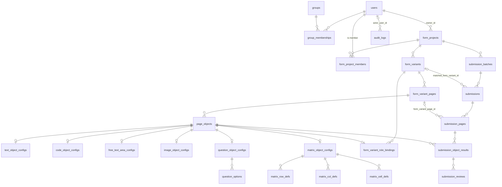

# FormScanner — Data model

This document describes the PostgreSQL schema of FormScanner: the tables, their columns, the enums, the constraints and how rows are created, copied and deleted. The SQLAlchemy models in `backend/app/models/` are the source; the schema is created by the Alembic migrations (see [architecture.md](architecture.md#5-database-and-migrations)). The meaning of the states and rules is in the [functional specification](functional-specification.md).

## Contents

1. [Overview](#1-overview)
2. [Conventions](#2-conventions)
3. [Users and access](#3-users-and-access)
4. [Authoring](#4-authoring)
5. [Scanning](#5-scanning)
6. [Audit](#6-audit)
7. [Enums](#7-enums)
8. [Copies and deletions](#8-copies-and-deletions)

## 1. Overview

The model has three parts:

- **Authoring:** a project (`form_projects`) has variants (`form_variants`), a variant has pages (`form_variant_pages`), a page has objects (`page_objects`). Each object has one typed configuration table chosen by its `object_type`; questions and matrices have child rows.
- **Scanning:** a project has batches (`submission_batches`), a batch has submissions (`submissions`, the sheets of one respondent), a submission has its scanned sheets (`submission_pages`), and each sheet has one reading per object it carries (`submission_object_results`), with the history of the review actions (`submission_reviews`).
- **Users and audit:** `users`, project membership (`form_project_members`) and `audit_logs`.

## 2. Conventions

- **Primary keys** are UUID v4, column `id`, generated by the application.
- **Timestamps** are `timestamptz`, stored and returned in UTC. Most rows have `created_at` and `updated_at`; pages, batches, memberships, role bindings, the review log and the audit log have `created_at` only.
- **Enums** are native PostgreSQL enum types, one type per column domain, named `<name>_enum` (section 7).
- **Foreign keys** have no `ON DELETE` action in the database: deletions are cascaded by the ORM, and the services refuse deletions that would remove content in use (section 8).
- **Ranges and cross-column rules** (a confidence in [0, 1], a positive width, the encoding of a barcode…) are validated by the API and the services, not by `CHECK` constraints.
- **File paths** stored in the database are absolute paths inside the storage directory; the API never returns them (see [architecture.md](architecture.md#7-file-storage)).
- **Page geometry** is in pixels of an A4 page at 96 dpi (794 × 1123), origin at the top-left corner. The printable PDF converts it to points (see [pdf-export.md](pdf-export.md)).
- **Aggregates** (pending review counts, scores during review, missing pages) are computed when read, not stored. The exceptions are stated where they occur.

## 3. Users and access

### `users`

| Column | Type | Notes |
|---|---|---|
| `email` | varchar(255) | Unique (`uq_users_email`) |
| `password_hash` | varchar(255) | bcrypt |
| `first_name`, `last_name` | varchar(255), null | |
| `full_name` | varchar(255), null | Not written by the application; `first_name` and `last_name` are used instead |
| `must_change_password` | bool | True when an administrator created the account or reset its password; cleared when the user changes it |
| `role` | `user_role_enum` | `USER` or `ADMIN` |
| `disabled` | bool | A disabled user cannot sign in |
| `last_login_at` | timestamptz, null | |
| `ui_theme` | `ui_theme_enum` | `LIGHT`, `DARK` or `SYSTEM` (default) |
| `avatar_path`, `avatar_mime`, `avatar_original_filename` | null | Profile picture; all null until one is uploaded |

### `form_project_members`

Access to a project is decided by this table: a user acts on a project if and only if they have a row here. Administrators act on every project, as an owner would, without a row.

| Column | Type | Notes |
|---|---|---|
| `project_id` | FK `form_projects` | |
| `user_id` | FK `users` | |
| `role` | `project_role_enum` | `OWNER` or `COLLABORATOR` |

Unique `(project_id, user_id)` (`uq_form_project_member`). A project always keeps at least one owner (enforced by the service).

### `groups`, `group_memberships`

User groups (`name`, `description`) and their members (`group_id`, `user_id`, `membership_role`: `MEMBER` or `MANAGER`, unique `(group_id, user_id)`). Present in the schema; no endpoint uses them.

## 4. Authoring

### `form_projects`

| Column | Type | Notes |
|---|---|---|
| `owner_id` | FK `users` | The creator, shown first among the members. Not the source of access: see `form_project_members` |
| `type` | `form_project_type_enum` | `EXAM`, `SURVEY`, `QUESTIONNAIRE`, `GENERIC_FORM`; informative |
| `name` | varchar(255) | |
| `description` | varchar(2000), null | |
| `event_date` | timestamptz, null | |
| `status` | `form_project_status_enum` | `DRAFT` (default), `ACTIVE`, `CLOSED`, `ARCHIVED`; transitions in the [functional specification, §2.2](functional-specification.md#22-form-project) |

### `form_variants`

| Column | Type | Notes |
|---|---|---|
| `form_project_id` | FK `form_projects` | |
| `version_number` | int | Sequential within the project, assigned at creation and at clone. Unique `(form_project_id, version_number)` (`uq_form_variant_version_number`) |
| `root_key` | varchar(255) | Grouping key shared by a variant and its clones; `variant-<version_number>` unless given at creation |
| `name` | varchar(255) | |
| `description` | varchar(2000), null | |
| `status` | `form_variant_status_enum` | `DRAFT` (default), `PUBLISHED`, `ARCHIVED` |
| `published_at` | timestamptz, null | Set when published |
| `original_file_path`, `original_filename` | null | Not written by the current features |
| `created_by_user_id` | FK `users` | |
| `updated_by_user_id` | FK `users`, null | |

### `form_variant_pages`

| Column | Type | Notes |
|---|---|---|
| `form_variant_id` | FK `form_variants` | |
| `page_index` | int | **1-based** position in the variant. Unique `(form_variant_id, page_index)` (`uq_form_variant_page_index`); pages are renumbered 1…n when reordered or removed. The printed variant identifier code can carry it (see [pdf-export.md](pdf-export.md)) |
| `width_px`, `height_px`, `dpi` | int, int, float; null | Page size; new pages are A4 at 96 dpi (794 × 1123) |
| `image_path` | varchar(1000), null | Not written by the current features |

### `page_objects`

One object placed on a page. `object_type` says which typed configuration table holds its data; exactly one is populated, consistent with the type (enforced by the services).

| Column | Type | Notes |
|---|---|---|
| `form_variant_page_id` | FK `form_variant_pages` | |
| `object_type` | `page_object_type_enum` | `TEXT`, `CODE`, `FREE_TEXT_AREA`, `QUESTION`, `MATRIX`, `IMAGE` |
| `x`, `y`, `width`, `height` | float | Page geometry (section 2) |
| `z_index` | int | Drawing order |
| `label` | varchar(255), null | Name of the object, shown in the editor and, when there is no question text, in the "Columns" sheet of the detail export |
| `description` | varchar(2000), null | |
| `visible` | bool | A hidden object stays in the variant but is not printed |
| `locked` | bool | Locked in the editor |
| `shared_group_id` | uuid, null | Linked copies (below) |
| `shared_across_pages` | bool | Linked copies (below) |

**Linked copies** ("Show on all pages", [functional specification, §2.6](functional-specification.md#26-linked-copies)): the copies of one object on several pages share a `shared_group_id`.

| `shared_group_id` | `shared_across_pages` | Meaning |
|---|---|---|
| null | false | An ordinary object of one page |
| set | true | A linked copy: editing or deleting it applies to every linked copy of the group |
| set | false | A copy that was unlinked; it remembers its group so it can be linked again |

Group ids are generated for each variant; a clone gets new ones.

### Typed configurations

One row per object, `page_object_id` unique (one-to-one).

| Table | For | Columns |
|---|---|---|
| `text_object_configs` | `TEXT` | `text`, `font_size` (int), `font_family` (null), `bold`, `italic` |
| `code_object_configs` | `CODE` | `code_type` (`QR` or `BARCODE`, `code_object_code_type_enum`), `encoding` (varchar, null: for a barcode one of `CODE128`, `CODE39`, `EAN13`, `EAN8`, `UPCA`; null for a QR code), `value` (varchar(2000)), `human_readable` (print the value under the code), `include_page_index` (the printed payload carries the page index; only on the code with the `VARIANT_IDENTIFIER` role) |
| `free_text_area_configs` | `FREE_TEXT_AREA` | `placeholder` (null), `max_length` (null) |
| `image_object_configs` | `IMAGE` | `file_path` (null until a picture is uploaded), `original_filename`, `mime_type` (from the content), `width_px`, `height_px` (raster pictures only), `fit` (`contain`, default, or `cover`) |
| `question_object_configs` | `QUESTION` | `question_type` (`SINGLE_CHOICE` or `MULTIPLE_CHOICE`), `question_text`, `shuffle_answers` |
| `matrix_object_configs` | `MATRIX` | `rows_count`, `cols_count`, `evaluative` (counts for the score), `selection_rule` (`matrix_object_selection_rule_enum`) |

Child rows:

| Table | Parent | Columns | Unique |
|---|---|---|---|
| `question_options` | `question_object_configs` | `order_index`, `option_text`, `is_correct`, `score` (float, null, may be negative) | `(question_object_config_id, order_index)` |
| `matrix_row_defs` | `matrix_object_configs` | `order_index`, `label` | `(matrix_object_config_id, order_index)` |
| `matrix_col_defs` | `matrix_object_configs` | `order_index`, `label` | `(matrix_object_config_id, order_index)` |
| `matrix_cell_defs` | `matrix_object_configs` | `row_index`, `col_index`, `is_correct`, `score` (float, null, may be negative) | `(matrix_object_config_id, row_index, col_index)` |

A matrix cell without a `matrix_cell_defs` row is neither correct nor scored.

### `form_variant_role_bindings`

The scanning role of an object ([functional specification, §4.1](functional-specification.md#41-scanning-roles)).

| Column | Type | Notes |
|---|---|---|
| `form_variant_id` | FK `form_variants` | |
| `page_object_id` | FK `page_objects` | |
| `role` | `page_object_role_enum` | `VARIANT_IDENTIFIER` or `RESPONDENT_IDENTIFIER` |

Unique `page_object_id` (an object holds at most one role) and unique `(form_variant_id, role)` (a role is held by at most one object per variant; the linked copies of that object share it). An object that holds a role cannot be deleted: the role must be removed first.

## 5. Scanning

### `submission_batches`

| Column | Type | Notes |
|---|---|---|
| `form_project_id` | FK `form_projects` | |
| `name` | varchar(255) | |
| `description` | varchar(2000), null | |
| `confidence_threshold` | float, null | The batch's threshold, in [0, 1]. Null means "use `DEFAULT_CONFIDENCE_THRESHOLD`", so a later change of the default reaches the batch |
| `created_by_user_id` | FK `users` | |

### `submissions`

The sheets of one respondent on one variant.

| Column | Type | Notes |
|---|---|---|
| `submission_batch_id` | FK `submission_batches` | |
| `status` | `submission_status_enum` | Lifecycle in the [functional specification, §11](functional-specification.md#11-submission-lifecycle) |
| `matched_form_variant_id` | FK `form_variants`, null | The variant, once matched or assigned by hand |
| `match_failure_reason` | `match_failure_reason_enum`, null | Why the variant could not be determined; cleared when it is |
| `match_failure_code_value` | varchar(500), null | With `VID_NOT_RECOGNISED`: the first identifier value read that belongs to no published variant |
| `respondent_identifier` | varchar(500), null | The candidate: read from the respondent identifier, or entered in review |
| `source_group_key` | varchar(500), null | What grouped loose images into this submission: a respondent identifier value or the group token of a file name. Null for a PDF upload and for an image that could not be grouped. Unique per batch when not null (partial unique index `uq_submissions_batch_source_group_key`): a later upload with the same key adds pages to the same submission |
| `unresolvable_from_status` | `submission_status_enum`, null | For `UNRESOLVABLE` only: the state "Undo unresolvable" returns to |
| `total_score` | float, null | Written when the submission is closed; during review the score is computed when read |
| `locked_by`, `locked_at` | FK `users`, timestamptz; null | Review lock: who holds it and their last activity. The lock is active while `locked_at` is recent; an expired lock is ignored, not cleared |
| `review_version` | int | Incremented by every review save; a save based on an older version is refused (see [api.md](api.md)) |
| `extraction_attempted_at` | timestamptz, null | Last time an extraction run examined the submission, with or without errors |

### `submission_pages`

One scanned sheet.

| Column | Type | Notes |
|---|---|---|
| `submission_id` | FK `submissions` | |
| `form_variant_page_id` | FK `form_variant_pages`, null | The page of the variant the sheet was matched to |
| `source_file_path` | varchar(1000) | The scanned image on disk |
| `source_filename` | varchar(500) | The uploaded file's name, for display |
| `source_page_order` | int | **0-based** position of the sheet in its submission: the order in the PDF, or the position declared by the code or the file name, or the order of arrival. **Not unique** within a submission: two sheets declaring the same position are both kept, and readers break ties by `created_at`, `id` |
| `page_order_source` | `page_order_source_enum` | Where `source_page_order` comes from: `CODE`, `FILENAME`, `PDF_ORDER` (physical order or order of arrival) |
| `identified_code_value` | varchar(1000), null | The raw variant identifier payload read on this sheet (`VID:<value>` or `VID:<value>\|<page_index>`); null if none was read |
| `match_confidence` | float, null | How the sheet was placed on a variant page: `1.0` the code declared the page index; `0.5` deduced from `source_page_order`; `0.0` the page does not exist in the variant (`form_variant_page_id` stays null). Null: matching never ran |
| `alignment_status` | `page_alignment_status_enum`, null | `ALIGNED` or `NOT_ALIGNED`; null until the first extraction run |
| `aligned_file_path` | varchar(1000), null | With `ALIGNED`: the straightened sheet, which the extractors read |
| `alignment_json` | jsonb, null | Diagnostics of the alignment (marks found, transformation, residual, reason); never read by a rule |

### `submission_object_results`

One reading: one object read on one sheet, and the current review decision on it.

| Column | Type | Notes |
|---|---|---|
| `submission_page_id` | FK `submission_pages` | |
| `page_object_id` | FK `page_objects` | |
| `result_type` | `submission_result_type_enum` | `QUESTION`, `MATRIX`, `FREE_TEXT`, `CODE`, `RESPONDENT_IDENTIFIER` |
| `detected_payload_json` | jsonb, null | What extraction read (shapes below). Null only for a placeholder created by "Review anyway", for an object no run could read |
| `confidence_score` | float, null | Aggregated confidence in [0, 1]: for a question, the lowest confidence among the options read as marked. Null when the type has no confidence; null never sends a reading to review by itself |
| `validity_forces_review` | bool | The reading needs a human whatever its confidence (invalid answer, free text, code not decoded, ambiguous or empty identifier column) |
| `sheet_not_aligned` | bool | The sheet could not be aligned; forces review |
| `review_required` | bool | Confidence below the effective threshold, or one of the two flags above. Stored, not computed: once a reading is resolved its value is frozen; for unresolved readings it is recomputed when the batch threshold changes |
| `review_outcome` | `review_outcome_enum`, null | The current decision: `CONFIRMED`, `SUBSTITUTED`, `FLAGGED`. **Resolved means `review_outcome IS NOT NULL`**; undo sets it back to null |
| `reviewed_payload_json` | jsonb, null | With `SUBSTITUTED`: the value the reviewer entered |
| `review_note` | varchar(2000), null | Note of the current decision |
| `reviewed_by`, `reviewed_at` | FK `users`, timestamptz; null | Author and time of the current decision |
| `auto_score`, `final_score` | float, null | Not written by the current features: the score is computed from the reading and the decision |
| `reviewed` | bool | Not written or read by the current features; `review_outcome` is the source |

Unique `(submission_page_id, page_object_id)` (`uq_submission_object_result_page_object`): an object read on a sheet has exactly one reading, and a second extraction run never duplicates it.

**Shapes of `detected_payload_json`** (Pydantic models in `backend/app/schemas/submission_result.py`):

| `result_type` | Shape |
|---|---|
| `QUESTION` | `{selected_options: [{option_id, confidence}], validity}` |
| `MATRIX` | `{rows: [{row_index, selected_cells: [{col_index, confidence}], validity}], cols: [{col_index, selected_cells: [{row_index, confidence}], validity}]}`; exactly one of `rows` and `cols` is filled, depending on the selection rule |
| `RESPONDENT_IDENTIFIER` | `{raw_value, digits: [{col_index, row_index, label, confidence}], ambiguous_columns: [int]}`; `raw_value` has one character per column, `?` where nothing was read |
| `FREE_TEXT` | `{suggested_text}`: the OCR suggestion, possibly empty |
| `CODE` | `{decoded_value, decode_successful}` |

`validity` is `VALID`, `NO_ANSWER` or `TOO_MANY_ANSWERS`.

**Shapes of `reviewed_payload_json`:** `QUESTION` `{selected_option_ids, validity}`; `MATRIX` `{rows: [{row_index, selected_col_indices, validity}], cols: [{col_index, selected_row_indices, validity}]}`; `FREE_TEXT` `{text}`; `CODE` `{value}`; any object with the `RESPONDENT_IDENTIFIER` role (a grid or a free-text area) `{value}`. The validity is always computed by the server.

### `submission_reviews`

Append-only history of the review actions on a reading. The current state is on `submission_object_results`; each action writes both in one transaction.

| Column | Type | Notes |
|---|---|---|
| `submission_object_result_id` | FK `submission_object_results` | |
| `reviewer_user_id` | FK `users` | |
| `action` | `review_action_enum` | `CONFIRMED`, `SUBSTITUTED`, `FLAGGED`, `UNDONE` |
| `review_note` | varchar(2000), null | Note given with this action |
| `reviewed_payload_json` | jsonb, null | With `SUBSTITUTED`: the value entered |

Review actions write no `audit_logs` row: this table is their trail.

## 6. Audit

### `audit_logs`

| Column | Type | Notes |
|---|---|---|
| `actor_user_id` | FK `users`, null | Who did it |
| `action` | varchar(255) | Dotted name, e.g. `form_variant.published`, `submission.closed` |
| `entity_type` | varchar(255) | |
| `entity_id` | varchar(255), null | |
| `metadata_json` | jsonb, null | Details of the action |

Indexed on `actor_user_id`, `action`, `entity_type`, `entity_id`. Rows are never updated or deleted.

## 7. Enums

| PostgreSQL type | Values |
|---|---|
| `user_role_enum` | `USER`, `ADMIN` |
| `ui_theme_enum` | `LIGHT`, `DARK`, `SYSTEM` |
| `project_role_enum` | `OWNER`, `COLLABORATOR` |
| `membership_role_enum` | `MEMBER`, `MANAGER` |
| `form_project_type_enum` | `EXAM`, `SURVEY`, `QUESTIONNAIRE`, `GENERIC_FORM` |
| `form_project_status_enum` | `DRAFT`, `ACTIVE`, `CLOSED`, `ARCHIVED` |
| `form_variant_status_enum` | `DRAFT`, `PUBLISHED`, `ARCHIVED` |
| `page_object_type_enum` | `TEXT`, `CODE`, `FREE_TEXT_AREA`, `QUESTION`, `MATRIX`, `IMAGE` |
| `page_object_role_enum` | `VARIANT_IDENTIFIER`, `RESPONDENT_IDENTIFIER` |
| `code_object_code_type_enum` | `QR`, `BARCODE` |
| `question_type_enum` | `SINGLE_CHOICE`, `MULTIPLE_CHOICE` |
| `matrix_object_selection_rule_enum` | `ONE_PER_ROW`, `MANY_PER_ROW`, `ONE_PER_COLUMN`, `MANY_PER_COLUMN`, `FREE` |
| `submission_status_enum` | `UPLOADED`, `UNASSIGNED`, `MATCHED`, `MATCH_FAILED`, `UNRESOLVABLE`, `SCANNED`, `REVIEWED`, `FINALIZED` (reserved: nothing writes it) |
| `match_failure_reason_enum` | `NO_PUBLISHED_VARIANT`, `NO_VID_FOUND`, `VID_NOT_RECOGNISED` |
| `page_order_source_enum` | `CODE`, `FILENAME`, `PDF_ORDER` |
| `page_alignment_status_enum` | `ALIGNED`, `NOT_ALIGNED` |
| `submission_result_type_enum` | `QUESTION`, `MATRIX`, `FREE_TEXT`, `CODE`, `RESPONDENT_IDENTIFIER` |
| `review_outcome_enum` | `CONFIRMED`, `SUBSTITUTED`, `FLAGGED` |
| `review_action_enum` | `CONFIRMED`, `SUBSTITUTED`, `FLAGGED`, `UNDONE` |

Two value sets are Python enums stored as text: the barcode encoding (`code_object_configs.encoding`) and the reading validity (inside the JSON payloads).

## 8. Copies and deletions

**Clone of a variant.** A new `DRAFT` variant in the same project, named `<name> (copy)`, with the next `version_number` and the same `root_key`; every page, object, typed configuration, option, matrix row, column and cell is copied. Linked copies get a new `shared_group_id`, and every IMAGE gets its own copy of the picture file. Scanning roles are not copied: the clone's objects hold no role until one is assigned. The clone shares nothing with its source.

**Deletions** are cascaded by the ORM inside one transaction, under these rules:

| Deleted | Allowed when | Removed with it |
|---|---|---|
| Project | Every variant is `DRAFT`; by an owner or an administrator | Members, variants with all their content |
| Variant | It is `DRAFT` and the project is not `ARCHIVED` | Pages, objects, configurations, child rows |
| Page | The variant and the project are `DRAFT`, and it is not the only page | Its objects; the remaining pages are renumbered |
| Object | The variant and the project are `DRAFT`, and the object holds no role | Its configuration and child rows; a linked copy takes every linked copy of its group with it |

Picture files of deleted IMAGE objects are removed from disk after the commit. Published variants, batches, submissions, sheets and readings are never deleted: a project can only be deleted while all its variants are drafts, and a project without published variants cannot have batches.
