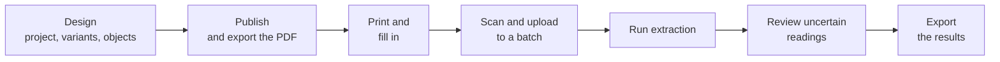

# 2. Concepts

This chapter explains the few ideas FormScanner is built on: what a project, a variant, a page and an object are on the designing side, and what a batch, a submission and a reading are on the scanning side. The exact terms are defined in the [glossary of the specification](../specification/functional-specification.md#appendix-glossary).

## Contents

1. [The big picture](#21-the-big-picture)
2. [Users and roles](#22-users-and-roles)
3. [Projects](#23-projects)
4. [Variants](#24-variants)
5. [Pages and objects](#25-pages-and-objects)
6. [Identifying sheets and respondents](#26-identifying-sheets-and-respondents)
7. [Batches, submissions and sheets](#27-batches-submissions-and-sheets)
8. [Readings, confidence and review](#28-readings-confidence-and-review)
9. [Score](#29-score)
10. [Results](#210-results)

## 2.1 The big picture

You design a form in the browser and export it as a PDF. The respondents fill in the printed sheets by hand. You scan the sheets and upload them; FormScanner works out which form and which page each sheet is, reads the marked answers and the handwriting, and shows a person only what it is not sure about. Once every submission has been checked, you export the results.

## 2.2 Users and roles

Everybody signs in with an email and a password. There are two kinds of account:

- **Administrator** (ADMIN): creates the other accounts, disables them and resets their passwords, and sees every project.
- **User** (USER): sees the projects they are a member of, and creates new ones.

Within a project, a user is either an **owner** or a **collaborator**:

| | Owner | Collaborator |
|---|---|---|
| Design the form, publish variants, export PDFs | yes | yes |
| Create batches, upload, extract, review, export results | yes | yes |
| Change the status of the project | yes | no |
| Add and remove members, make someone owner | yes | no |
| Delete the project | yes | no |

Whoever creates a project is its first owner. A project always has at least one owner. All members see all the batches and submissions of the project: several people can review the same batch at the same time.

## 2.3 Projects

A **project** is one exam, survey or questionnaire. It has a name, an optional description and event date, and a type (exam, survey, questionnaire, generic form: the type is only informative).

A project goes through four statuses:

| Status | What you do in it |
|---|---|
| `DRAFT` | Design the form: create and edit variants, publish them. |
| `ACTIVE` | Collect the filled-in sheets: create batches and upload scans. Variants can no longer be edited, but a draft variant can still be published. |
| `CLOSED` | Collection is over: no new batches or uploads. Existing batches can still be extracted, reviewed and exported. |
| `ARCHIVED` | Final: it cannot be undone. No new batches or uploads, and the variants and the members can no longer be changed. Existing batches can still be extracted, reviewed and exported. |

A project can be activated only when it has at least one published variant. It can go back from `ACTIVE` or `CLOSED` to `DRAFT` (**Reopen**), for example to clone a variant. See [4.1](04-reference.md#41-projects).

## 2.4 Variants

A **variant** is one printable version of the form. Most projects have one; an exam with versions A, B and C, with the questions in a different order, has three.

- A variant is a **draft** while you design it. You can change everything.
- When it is ready, you **publish** it. A published variant can be printed and recognised by scanning, and it never changes again: to change it, you **clone** it into a new draft, edit the clone and publish it.
- Only published variants take part in scanning.

When a project has more than one published variant, every printed sheet must say which variant it is: this is the job of the **variant code** (2.6).

## 2.5 Pages and objects

A variant has one or more A4 portrait **pages**. On a page you draw **objects**, each of one type:

| Object | What it is | Read from the scan? |
|---|---|---|
| **Text** | Printed text: title, instructions, headings | no |
| **Image** | A picture: a logo, a figure for a question | no |
| **Code** | A QR code or a barcode | its value, as information |
| **Free text** | A box where the respondent writes by hand | by OCR, always checked by a person |
| **Question** | A question with its options, single or multiple choice, each option with a bubble | yes, and scored |
| **Matrix** | A grid of bubbles with labelled rows and columns | yes; scored if marked **Evaluative** |

The options of a question and the cells of a matrix can be marked **correct** and given a **score**, also negative. The score is what counts for the result; the "correct" mark only fills the bubbles of the solution PDF.

An object can be **shown on all pages**: it is copied onto every page added afterwards, and the copies stay linked, so that editing one edits all of them. A header with the name of the exam, or the variant code, are typical examples.

Along the four edges of every page runs a 15 mm **reserved band** that holds the **alignment marks**: black squares in the corners and bars along the sides. FormScanner uses them to straighten each scanned sheet before reading it. Objects cannot be placed in the bands.

## 2.6 Identifying sheets and respondents

Two objects can be given a **scanning role**:

- **Variant identifier**: a code that says which variant a sheet is. It is needed only when the project has more than one published variant. It must be shown on all pages, and it can also print the page number, so that every sheet says which page it is.
- **Respondent identifier**: what says *who* filled in the sheets. It can be a code printed or stuck on the sheet, a grid where the respondent marks their student number one digit per column, or a free-text box where they write their name.

Both are optional: a project with a single variant needs no variant code, and an anonymous questionnaire needs no respondent identifier. FormScanner keeps no register of respondents: the identifier read from the sheet (the **candidate**) is exported as it is, and matching it to a real person happens outside.

## 2.7 Batches, submissions and sheets

On the scanning side:

- A **batch** is a scan session: one upload or many, for example "Morning session" or "Room 3". It belongs to one project and may hold sheets of all its variants.
- A **submission** is the set of sheets filled in by one respondent: it gets one score and one row in the results. The simplest way to upload is **one PDF per respondent**: each PDF becomes one submission. Loose JPEG or PNG images are grouped into submissions by the respondent code or by their file names.
- A **sheet** is one scanned page. FormScanner binds each sheet to a page of its variant; a page with no sheet is listed as a **missing page**.

Each submission has a **status** that tells where it is in the process:

| Status | Meaning | Filter in the batch page |
|---|---|---|
| `MATCHED` | Variant known, waiting for extraction | To extract |
| `MATCH_FAILED` | The variant could not be recognised: a person assigns it | To assign |
| `UNASSIGNED` | A loose image that could not be grouped | Unassigned |
| `SCANNED` | Read, ready for review | To review / Ready to close |
| `REVIEWED` | Closed by a reviewer | Reviewed |
| `UNRESOLVABLE` | Set aside by a reviewer: no variant or no grouping can be found | Unresolvable |

The full life of a submission is described in the [specification, chapter 11](../specification/functional-specification.md#11-submission-lifecycle).

## 2.8 Readings, confidence and review

**Extraction** reads every object of every sheet: which bubbles are marked, the value of the codes, the handwriting. Each result is a **reading**. It is started by hand with **Run extraction**, when you are ready.

For each reading FormScanner measures its **confidence**: how sure it is of what it saw, from 0 to 100%. A reading needs **review** by a person when:

- its confidence is below the batch's **confidence threshold** (70% unless changed);
- the marks break the rule of the question: nothing marked, or two bubbles on a single-choice question;
- it is handwriting (always);
- a code could not be decoded, or the sheet could not be straightened.

Everything else is accepted as read. A reviewer looks at each reading in review next to the image of the sheet and **confirms** it, **replaces** it with the right answer, or **flags** it as impossible to tell. When nothing is left, the reviewer **closes** the submission.

## 2.9 Score

The score of a submission is the sum of the scores of the options and cells it marked. Some rules keep it fair:

- an answer that is not clear never earns points: two bubbles on a single-choice question score at most 0 (or the negative points of the options chosen);
- marking every option of a question scores 0;
- an answer that is not given, flagged or never reviewed scores 0.

The score is shown as points, maximum and percentage, for example "12 / 18 (66.7%)". The maximum is the same for every submission of a variant, and the editor shows it while you design the form. The full rules are in the [specification, chapter 9](../specification/functional-specification.md#9-scoring).

## 2.10 Results

When every submission of a batch is closed or set aside, and at least one is closed, the batch can be **exported**:

- the **summary**: one row per submission, with the candidate, the variant, the points, the maximum, the percentage and the missing pages;
- the **detail**: the same, plus the answer and the points of every question.

Both are available as CSV or as an Excel workbook.
