# 3. Walkthrough

This chapter goes through a complete job, from an empty installation to the exported results: a short quiz, designed in the browser, printed, filled in by four students, scanned, read, reviewed and exported. Follow it on your own installation the first time you use FormScanner; every step is also described in the [reference](04-reference.md).

The quiz of this chapter, "Sample quiz", has one page with:

- a title and a line of instructions;
- a box where the student writes their name;
- a grid where the student marks their five-digit student number;
- six multiple-choice questions, worth one point for each correct answer.

## Contents

1. [Sign in](#31-sign-in)
2. [Create a colleague's account](#32-create-a-colleagues-account)
3. [Create the project](#33-create-the-project)
4. [Create the variant](#34-create-the-variant)
5. [Draw the first question](#35-draw-the-first-question)
6. [Complete the form](#36-complete-the-form)
7. [Publish and print](#37-publish-and-print)
8. [Activate the project and share it](#38-activate-the-project-and-share-it)
9. [Fill in and scan](#39-fill-in-and-scan)
10. [Create a batch and upload the scans](#310-create-a-batch-and-upload-the-scans)
11. [Run extraction](#311-run-extraction)
12. [Review](#312-review)
13. [Export the results](#313-export-the-results)
14. [What next](#314-what-next)

## 3.1 Sign in

Open FormScanner in the browser (<http://localhost:8080> on the machine where it is installed, [1.3](01-installation.md#13-first-start)) and sign in with the administrator's email and password.

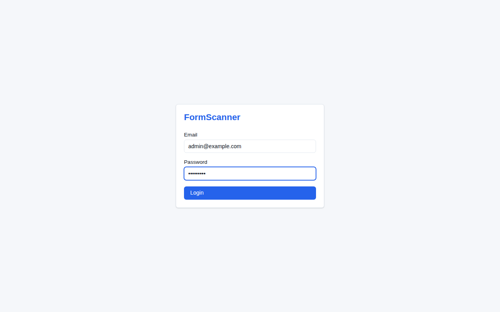

The first page is the list of projects, empty for now.

The administrator account has no name yet. Open the menu of your avatar, top right, and choose **Profile**. Fill in **First name** and **Last name** (in this chapter, "Alex Example") and click **Save**: the other members see this name, for example in the list of members and next to the readings you correct. In the same page, under **Change password**, replace the password of the installation with your own: **Current password**, then **New password** and **Confirm new password**, and **Update password**.

## 3.2 Create a colleague's account

If a colleague will review the sheets with you, create their account now. Open the menu of your avatar, top right, and choose **Add user**. Fill in **First name**, **Last name**, **Email** and a **Temporary password**, then click **Create user**.

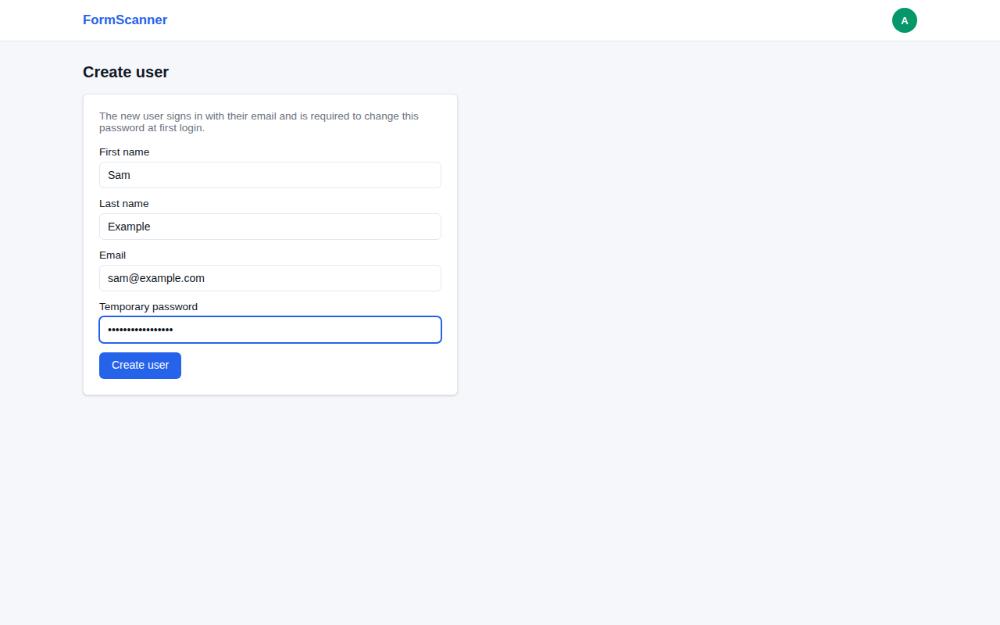

Give your colleague the email and the temporary password: at their first sign-in, FormScanner asks them to choose their own password.

## 3.3 Create the project

Click **FormScanner**, top left, to go back to the projects. Click **+ New project**, type the **Name** ("Sample quiz"), and if you like a **Description** and the **Event date**. Leave **Type** as EXAM. Click **Create project**.

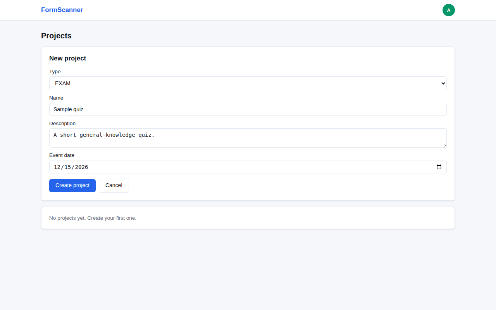

The project appears in the list, with the status DRAFT: you can design it. Click it to open it.

## 3.4 Create the variant

A project holds one or more variants: the printable versions of the form. This quiz has one. On the **Variants** tab, click **+ New variant**, type the **Name** ("Version A") and click **Create variant**.

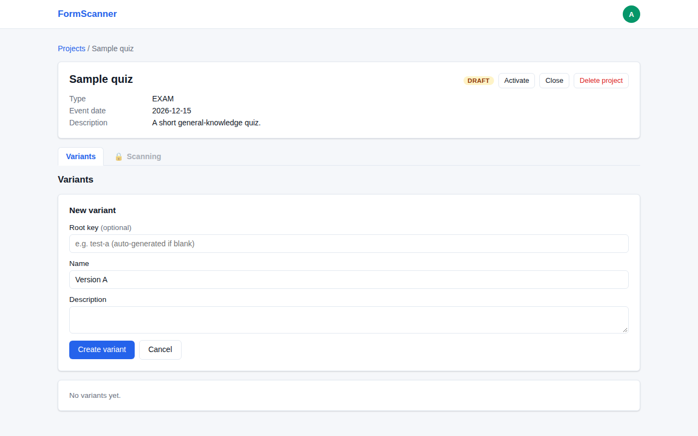

The editor opens on the first page of the new variant, an empty A4 page. The hatched band along its edges is reserved for the alignment marks, the black squares and bars that FormScanner uses to straighten the scans: nothing can be placed there.

## 3.5 Draw the first question

1. In **Add object**, choose **◉ Question**.
2. On the page, drag a rectangle where the question goes: here about half the width of the page, and tall enough for the question and its four options.
3. When you release the mouse, the form **Add QUESTION object** opens. Fill it in:
   - **label**: "Question 1". The label is how the question is called in the lists and in review; it is not printed.
   - **Question type**: SINGLE_CHOICE (one answer).
   - **Question text**: "What is the capital of France?"
   - **Options**: click **+ Add option** twice to have four, type them ("Berlin", "Madrid", "Paris", "Rome") and tick ✓ next to the correct one.
4. Click **Add QUESTION object**.

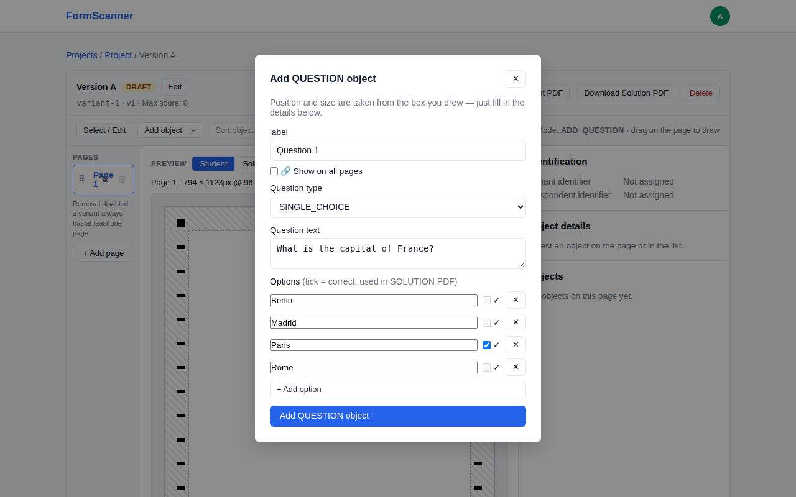

The question is on the page. Now give it a score. Click it (on the page or in the **Objects** list): its panel opens on the right. Under **Type configuration**, each option has a **score** field: type `1` next to "Paris" and click **Save**. The variant bar now shows **Max score: 1**.

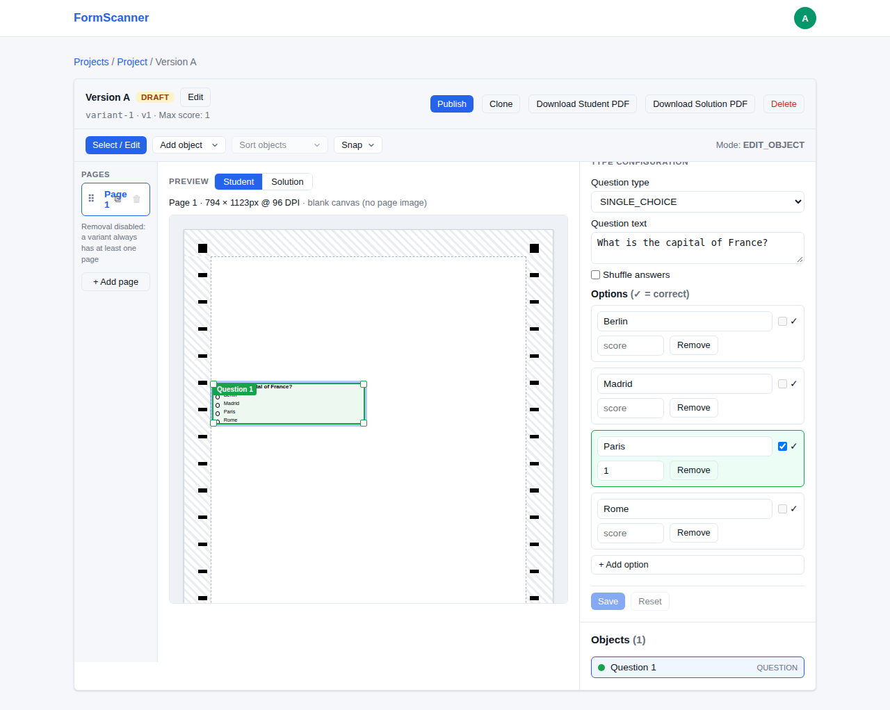

The ✓ only marks the option in the solution PDF: the score is what counts for the result. An option without a score is worth 0, even if it is ticked.

To move the question, drag it; to resize it, drag a corner. If the options do not all show on the page, make the rectangle taller.

## 3.6 Complete the form

Add the other objects the same way: choose the type in **Add object**, draw the rectangle, fill in the form.

- **Title and instructions:** two **T Text** objects at the top, with the text "Sample quiz: general knowledge" (size 18, **Bold**) and "Fill each bubble completely with a dark pen. Write your name in capital letters." (size 10).
- **The name:** a **¶ Free text** object with the label "Name", below the instructions. The label is printed above the box. FormScanner reads the handwriting as a suggestion, and a reviewer always checks it.
- **The student number:** a **▦ Matrix** object at the top right, with the label "Student number":
  - **Rows** 10 and **Columns** 5 (one column per digit), **Selection rule** ONE_PER_COLUMN, **Evaluative** not ticked;
  - **Row labels** 0, 1, 2 … 9 (the digit each row stands for) and **Column labels** 1 to 5;
  - click **Next →** and then **Add MATRIX object**: the second step (scores of the cells) is not needed.

  Then, with the matrix selected, click **Set as Respondent identifier** in the **Special role** section. The **Identification** box now shows "Respondent identifier: Student number — p. 1": the number marked by the student identifies the sheets.
- **The other questions:** five more questions, each with its options, the correct one ticked and a score of 1. Question 3, "Which of these are prime numbers?", is MULTIPLE_CHOICE with two correct options, "2" and "7", one point each.

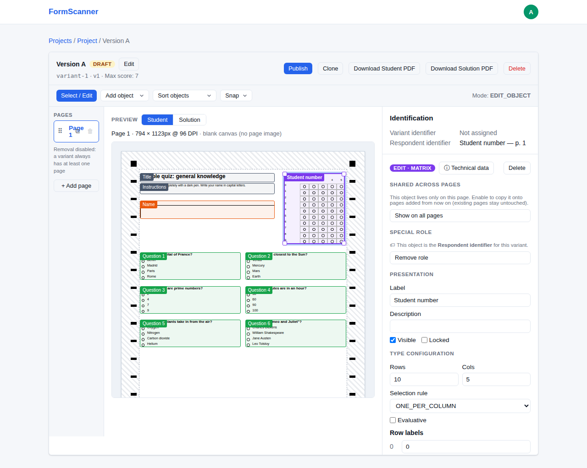

The variant bar shows **Max score: 7**. Click **Download Student PDF** to see the page exactly as it will be printed; check that every option is visible.

This quiz has a single variant, so it needs no variant code. With several variants (A, B, C), each needs a QR code with the **Variant identifier** role: see [4.4](04-reference.md#44-scanning-roles).

## 3.7 Publish and print

When the form is ready, click **Publish** and confirm. A published variant can no longer be changed: what you print is exactly what FormScanner will read. To change it later, you would **Clone** it into a new draft.

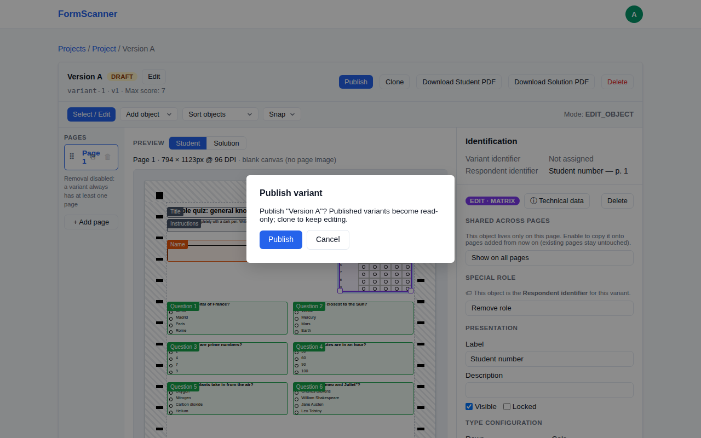

Click **Download Student PDF**: this is the sheet to print, with empty bubbles and the alignment marks along the edges.

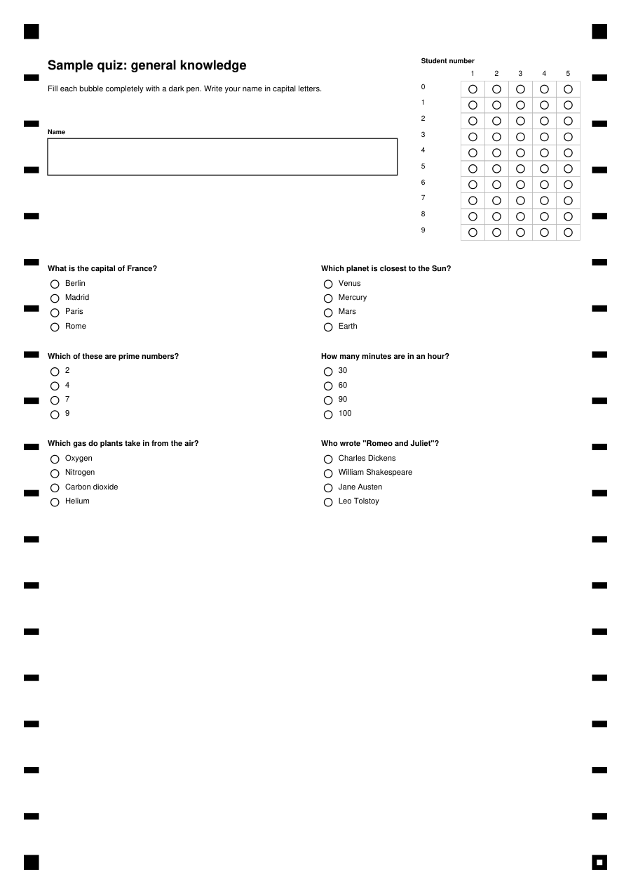

Print it at 100% scale ("Actual size"), on A4 paper, one copy per student. [Chapter 5](05-printing-and-scanning.md#52-printing) has the details.

## 3.8 Activate the project and share it

To scan, the project must be active. Go back to the project (the **Project** link at the top of the editor) and click **Activate**. Confirm: from now on the variants cannot be edited, and the **Scanning** tab is open.

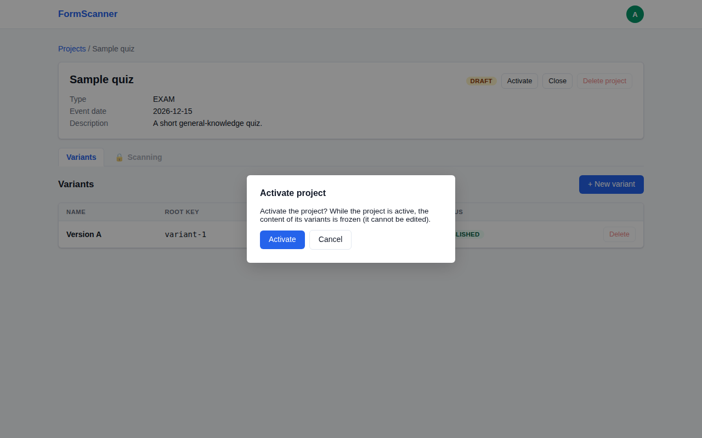

To share the work with your colleague, go back to the list of projects and click the avatars in the **Members** column of "Sample quiz". In **Project members**, click **Add collaborators**, search for your colleague by name or email and click **Add**. Collaborators can upload, review and export like you.

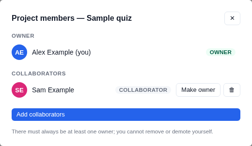

## 3.9 Fill in and scan

Hand out the sheets. The students write their name, mark their student number one digit per column, and fill one bubble per question (two for question 3).

Scan the filled-in sheets: greyscale or colour, 150 to 300 dpi, the whole page with its four corners. Save **one PDF per student**: each PDF becomes one submission, and FormScanner never has to guess which sheets belong together. Most scanners with a document feeder can do this; [chapter 5](05-printing-and-scanning.md#54-scanning) has more advice.

In this chapter, four students filled in the quiz: Jane Doe, John Smith, Erika Example and Max Sample. This is John Smith's sheet: he marked "Mercury" lightly, two answers on question 4, and a couple of wrong ones.

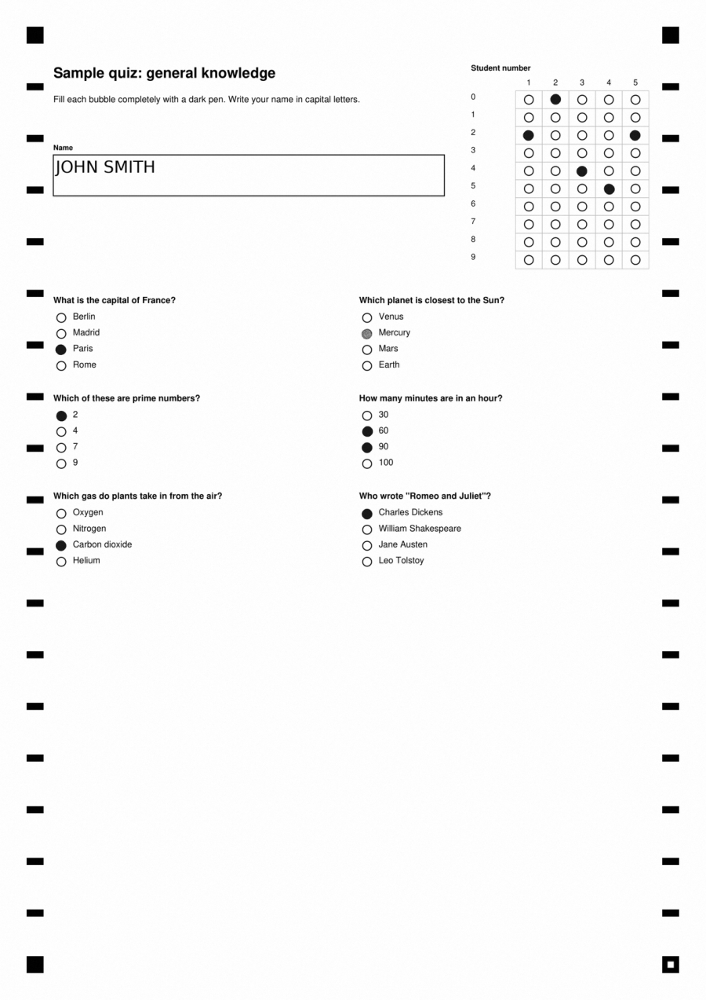

## 3.10 Create a batch and upload the scans

A batch is one scan session. Open the project, click the **Scanning** tab, then **+ New batch**. Type a **Name** ("Morning session") and click **Create batch**.

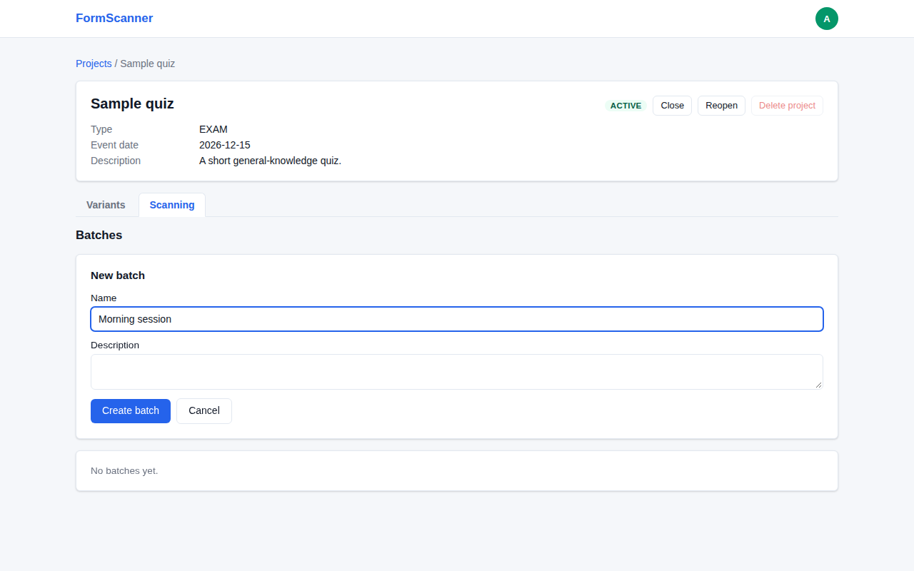

The batch page opens, with the upload area. Drag the four PDFs onto it, or click it to choose them. They are listed below; click **Upload 4 files**.

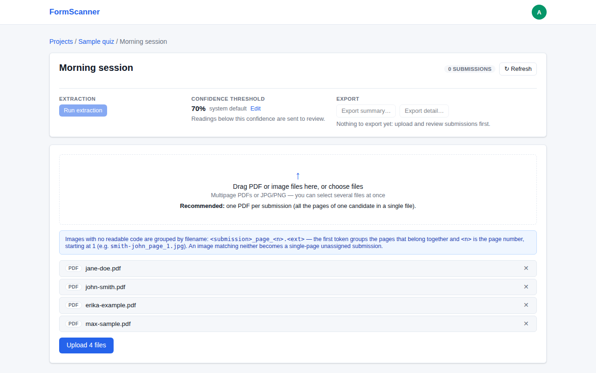

Each PDF shows "✓ Submission created", and the list shows the four submissions. FormScanner has recognised the form and the page of each sheet, but has not read the answers yet: the submissions wait in **To extract**.

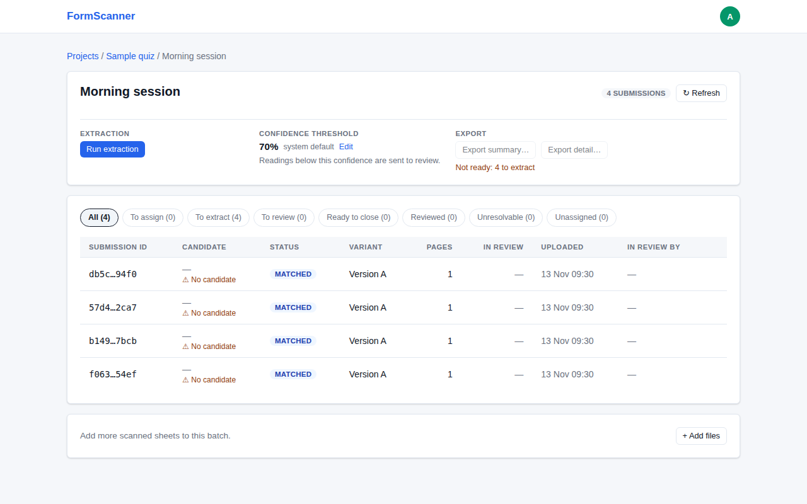

## 3.11 Run extraction

Click **Run extraction**. FormScanner straightens every sheet on its alignment marks and reads every object. With four sheets it takes a few seconds; with hundreds, a few minutes: keep the page open.

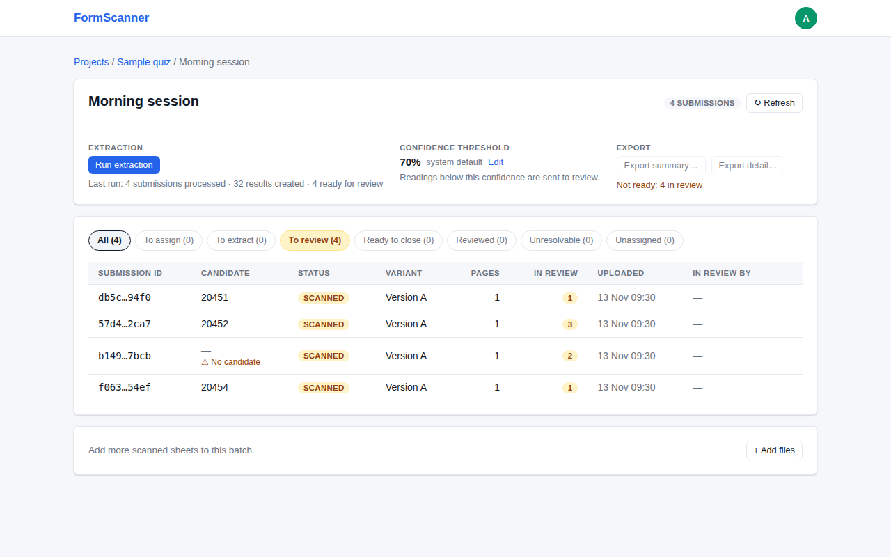

Every submission is now SCANNED, and **In review** says how many of its readings need a person:

- **Jane Doe** (20451) and **Max Sample** (20454): 1 each, the name. Handwriting is always checked.
- **John Smith** (20452): 3, the name and two answers.
- **Erika Example**: 2, the name and the student number. FormScanner could not read her number with certainty, so she has no candidate yet ("⚠ No candidate").

Everything else was read with enough confidence and is accepted as read.

## 3.12 Review

Click John Smith's submission. On the left is the list of his readings that need review; on the right, the selected reading with the scan of that part of the sheet.

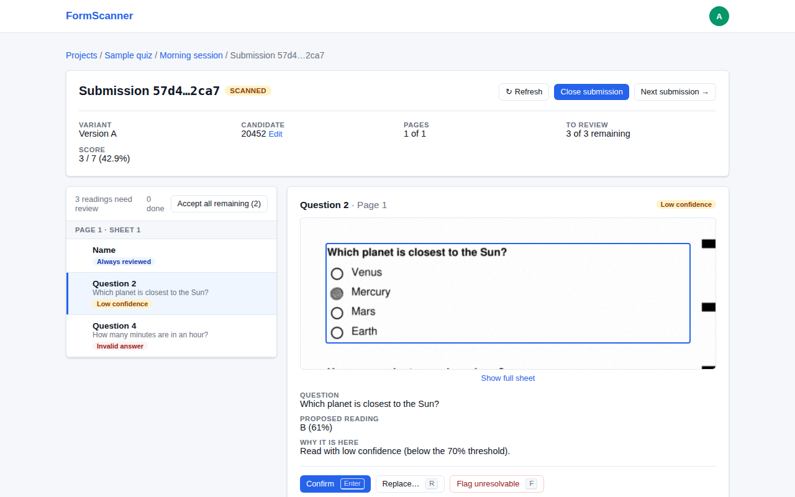

The header shows his candidate, the readings still to review and the score so far: "3 / 7 (42.9%)". Readings still to review count 0 points until someone resolves them.

Go through the readings:

- **Question 2**, "Low confidence": the scan shows "Mercury" marked lightly, and the proposed reading is "B (61%)", below the threshold of 70%. The reading is right: click **Confirm** (or press Enter). The score rises to 4 / 7.
- **Question 4**, "Invalid answer": John marked two answers on a single-choice question. The reading is what is on the paper: **Confirm** it. Two answers are never worth points, so the question scores 0.
- **Name**, "Always reviewed": the box shows the OCR suggestion. If it is not exactly the name, click **Replace…**, type "John Smith" and click **Save replacement**.

If a reading is wrong, **Replace…** lets you enter what the sheet shows; if the sheet cannot be read even on paper, **Flag unresolvable**. Each action moves to the next reading. When nothing is left to review, click **Close submission**: the score is saved and the submission becomes read-only.

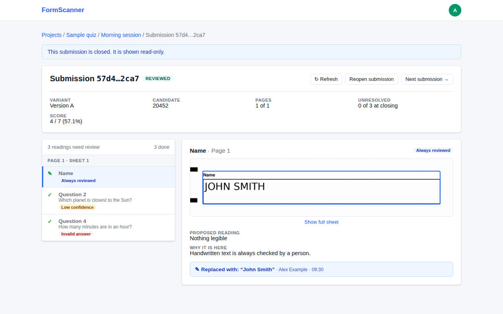

Go back to the batch (the **Morning session** link at the top) and open the submission with "⚠ No candidate". Select **Student number**: the reading "20453" has "Ambiguous digits", because two digits, 5 and 6, are marked in the fourth column. Find out which is right (from Erika, or from your list of students), click **Replace…**, type the student number and click **Save replacement**. It becomes the candidate of the submission.

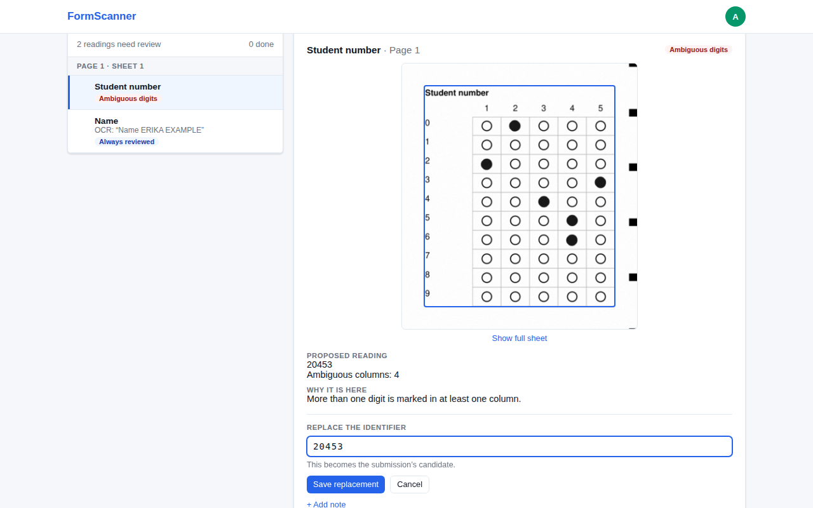

Check her name as well, then close the submission. Do the same for Jane Doe and Max Sample: check the name, close.

**Next submission →**, at the top of the review page, opens the next submission waiting for review, so you can go through a batch without coming back to the list. A colleague can review other submissions of the same batch at the same time: the list shows who is working on which (🔒).

## 3.13 Export the results

Back on the batch page, every submission is in **Reviewed**, and the export commands are enabled.

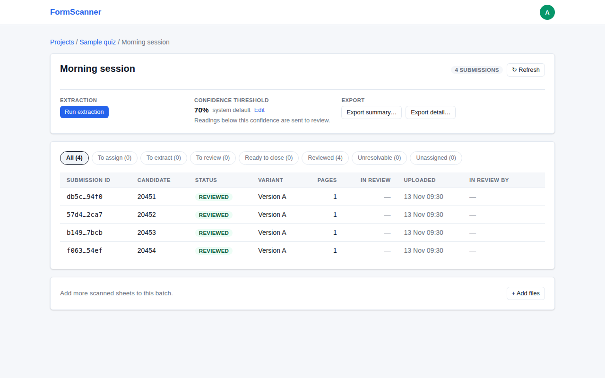

Click **Export summary…**. Choose the **Format** (here **Excel workbook (.xlsx)**), keep or change the **File name** and click **Download**.

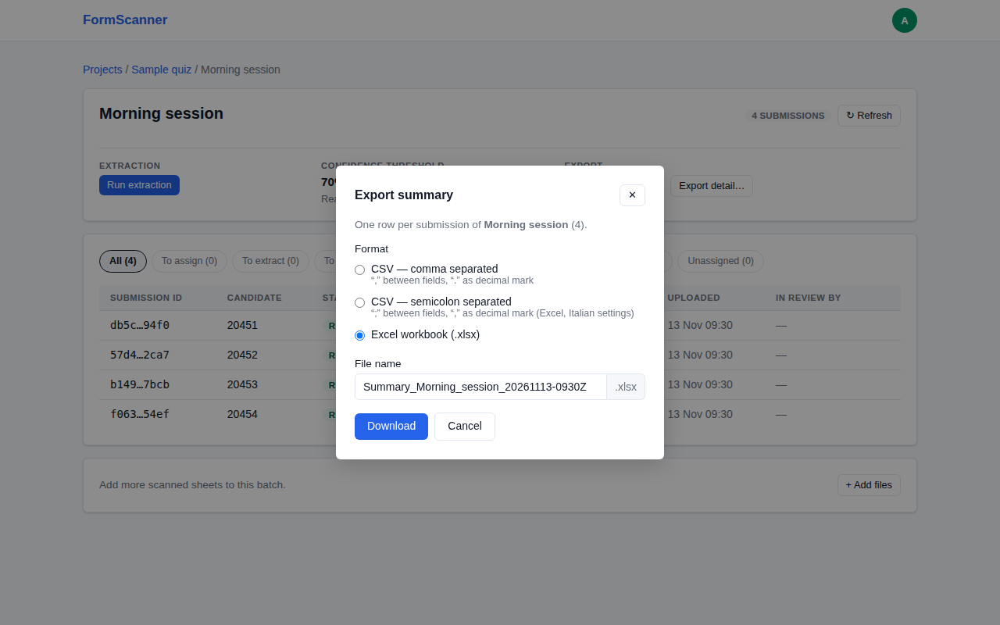

The summary has one row per student: the candidate (the student number), the variant, the points, the maximum and the percentage. For this quiz: Jane Doe 7, John Smith 4, Erika Example 6, Max Sample 5, out of 7. **Export detail…** adds the answer and the points of every question. The columns are described in [4.9](04-reference.md#49-results-export).

## 3.14 What next

- More sheets for the same quiz: upload them to the same batch, or create a new batch for each session, then **Run extraction** again.
- A quiz with several versions: [4.4](04-reference.md#44-scanning-roles) explains the variant code.
- Sheets that are hard to read, submissions that wait in **To assign** or **Unassigned**, an export that stays disabled: [chapter 5](05-printing-and-scanning.md#56-common-problems).
- Fewer or more readings in review: change the batch's **Confidence threshold** ([4.8](04-reference.md#48-confidence-threshold)).
